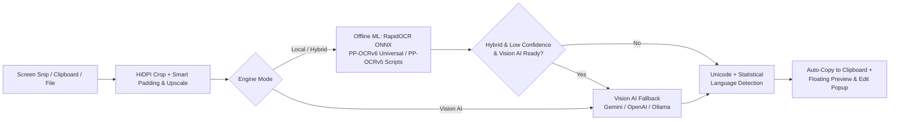

# OCRSnippingTool

> **Snipping Tool (`Win+Shift+S`), reimagined — drag over any part of your screen to extract text with Hybrid AI/ML OCR, automatic multilingual language detection, instant clipboard copy, and a sleek floating preview/edit popup.**

[](https://github.com/chryow/OCRSnippingTool/actions/workflows/ci.yml)
[](https://www.python.org/)
[](https://www.riverbankcomputing.com/software/pyqt/)
[](LICENSE)

---

## Highlights

- **Win+Shift+S Style Snipping Overlay** — Freezes your desktop across single or multi-monitor HiDPI displays, dims everything outside your selection, displays live pixel dimensions & crosshair guides, and cancels cleanly with `Esc` or right-click.
- **Hybrid AI/ML OCR Pipeline** — Best of both worlds:
  1. **Offline Deep-Learning OCR (RapidOCR + ONNX Runtime)** runs locally in milliseconds with zero API keys required. Uses the universal **PP-OCRv6** model by default plus on-demand **PP-OCRv5** specialized models covering **100+ languages**.
  2. **Optional Vision AI (Gemini, OpenAI / Compatible, or Local Ollama VLMs)** automatically enhances low-confidence or empty snips in Hybrid mode — or runs on demand via the **`✨ AI Enhance`** button — to handle **all world languages, handwriting, vertical text, math, and complex layouts**.
- **Automatic Multilingual Detection** — Combines Unicode script inspection (25+ writing systems) with statistical n-gram detection across 70+ languages, identifying single and mixed-language text (e.g., `English, Japanese`) and surfacing it directly in the popup.
- **Instant Auto-Copy + Floating Preview/Edit Popup** — Automatically copies extracted text to your clipboard while opening a draggable dark-mode card where you can edit text, re-copy, switch offline script models, or trigger **`✨ AI Enhance`** on the same capture without re-snipping.
- **System Tray + Global Hotkey + Headless CLI** — Trigger from anywhere with `Ctrl+Shift+X` (customizable), left-click the tray icon, extract from clipboard/image files, or script OCR from the command line.

---

## How the Hybrid Pipeline Works



---

## Supported Languages

| Mode | Script / Model | Coverage |
| --- | --- | --- |
| **Offline (`Auto`)** | `PP-OCRv6` Universal | English, Latin languages (French, Spanish, German, Portuguese, Indonesian, etc.), Simplified & Traditional Chinese, Japanese (Kanji + Kana), Greek |
| **Offline (Script Profiles)** | `PP-OCRv5` Specialized | Latin/European (80+ langs), Korean (Hangul), Russian / Ukrainian / Belarusian (`eslav`), All Cyrillic, Arabic / Persian / Urdu, Devanagari (Hindi, Marathi, Nepali), Thai, Greek, Tamil, Telugu |
| **Vision AI (Optional)** | Gemini / OpenAI / Ollama | **All world languages**, mixed scripts, cursive/handwriting, dense tables, code snippets, and formulas |

---

## Quick Start

### 1. Clone & Install

```bash
git clone https://github.com/chryow/OCRSnippingTool.git
cd OCRSnippingTool

python -m venv .venv

# Windows (PowerShell)
.venv\Scripts\Activate.ps1
# macOS / Linux
source .venv/bin/activate

pip install -r requirements.txt
```

### 2. Run the Desktop App

```bash
# Start in the system tray (press Ctrl+Shift+X or left-click the tray icon to snip)
python -m ocr_snip

# Or launch directly into a snip overlay
python -m ocr_snip --snip
```

### 3. Controls & Shortcuts

| Action | Shortcut / Trigger |
| --- | --- |
| Start a new OCR snip | `Ctrl + Shift + X` *(customizable)* or **left-click** tray icon |
| Cancel snipping overlay | `Esc` or **Right-click** |
| Extract from clipboard image / file | **Right-click** tray icon → menu |
| Re-scan with another script or AI | Script dropdown or **`✨ AI Enhance`** inside the floating popup |
| Close floating popup | `Esc` or `✕` |

---

## Optional Vision AI Configuration

Offline ML OCR works immediately with no keys or internet connection. To enable **Hybrid auto-fallback** or one-click **`✨ AI Enhance`**, open **Settings → Vision AI** (or set an environment variable):

| Provider | Environment Variable | Default Model | Notes |
| --- | --- | --- | --- |
| **Google Gemini** | `GEMINI_API_KEY` | `gemini-2.5-flash` | Sent via `x-goog-api-key` header (never in URLs) |
| **OpenAI / Compatible** | `OPENAI_API_KEY` | `gpt-4o-mini` | Customizable Base URL (works with OpenRouter, Groq, LM Studio, vLLM) |
| **Ollama (Local)** | *(none)* | `qwen2.5vl:7b` | 100% local Vision LLM at `http://localhost:11434` |

---

## Headless CLI Usage

Use `OCRSnippingTool` directly from scripts or terminals:

```bash
# Extract text + detected language from an image
python -m ocr_snip --image screenshot.png

# Structured JSON output
python -m ocr_snip --image screenshot.png --json

# Pick a specific offline script model
python -m ocr_snip --image menu_kr.png --script korean
python -m ocr_snip --image doc_ru.png --script eslav

# Force Vision AI directly
python -m ocr_snip --image handwriting.png --mode vision_ai
```

---

## Packaging as a Standalone Executable (`.exe` / App)

```bash
pip install pyinstaller
python build_exe.py
```

The standalone bundle is generated in `dist/OCRSnippingTool/`.

---

## Project Structure

```text
OCRSnippingTool/
├── ocr_snip/
│   ├── __main__.py              # Desktop + CLI entry point
│   ├── config.py                # Persistent JSON config (~/.config or %APPDATA%)
│   ├── language.py              # Unicode script + statistical multilingual detector
│   ├── capture/
│   │   ├── screenshot.py        # Multi-monitor HiDPI-aware screen capture (mss)
│   │   └── hotkey.py            # Cross-platform global hotkey bridge (pynput)
│   ├── ocr/
│   │   ├── base.py              # OCRResult, OCRLine, OCREngine interfaces
│   │   ├── local_rapidocr.py    # Offline RapidOCR (ONNX PP-OCRv6 & PP-OCRv5)
│   │   ├── vision_ai.py         # Gemini, OpenAI-compatible, and Ollama Vision AI
│   │   └── manager.py           # Hybrid OCR orchestrator
│   └── ui/
│       ├── app.py               # Main QApplication controller, tray, async QThread worker
│       ├── overlay.py           # Fullscreen Win+Shift+S selection overlay
│       ├── result_popup.py      # Draggable floating preview/edit popup
│       ├── settings_dialog.py   # General / OCR Engine / Vision AI settings dialog
│       └── theme.py             # Dark slate stylesheet + vector icon generator
├── tests/                       # Unit, end-to-end OCR, and headless PyQt6 UI tests
├── build_exe.py                 # PyInstaller bundler helper
├── pyproject.toml
└── requirements.txt
```

---

## Development & Testing

```bash
pip install -e ".[dev]"
QT_QPA_PLATFORM=offscreen pytest -v
```

### Platform Notes

- **Windows**: Works out of the box with global hotkeys and HiDPI scaling.
- **macOS**: Grant **Screen Recording** and **Accessibility** permissions (for global hotkeys) to your terminal or packaged app in *System Settings → Privacy & Security*.
- **Linux**: Works natively on X11. On Wayland, global hotkeys may require binding a desktop shortcut to `python -m ocr_snip --snip` in your window manager settings.

---

## License

MIT — see [LICENSE](LICENSE).
