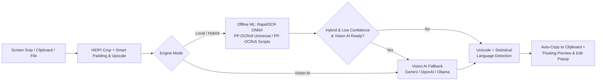

# OCRSnippingTool

> **Snipping Tool (`Win+Shift+S`), reimagined — drag over any part of your screen to extract text with Hybrid AI/ML OCR, automatic multilingual language detection, instant clipboard copy, and a sleek floating preview/edit popup.**

[](https://github.com/chryow/OCRSnippingTool/actions/workflows/ci.yml)
[](https://github.com/chryow/OCRSnippingTool/releases/latest)
[](https://www.python.org/)
[](https://www.riverbankcomputing.com/software/pyqt/)
[](LICENSE)

---

## Easy Download (No Python Required!)

Grab the latest pre-built app directly from the **[Releases Page](https://github.com/chryow/OCRSnippingTool/releases/latest)**:

| Operating System | File to Download | How to Run |
| --- | --- | --- |
| **Windows (x64)** | `OCRSnippingTool-Windows-x64-Portable.exe` *(single file)*<br/>or `OCRSnippingTool-Windows-x64.zip` *(faster startup)* | Double-click `OCRSnippingTool.exe` — no installation needed! |
| **macOS (Apple Silicon)** | `OCRSnippingTool-macOS-arm64.zip` | Unzip and drag `OCRSnippingTool.app` into **Applications**. |
| **Linux (x64)** | `OCRSnippingTool-Linux-x64.tar.gz` | Run `tar -xzf OCRSnippingTool-Linux-x64.tar.gz && ./OCRSnippingTool/OCRSnippingTool`. |

> **First run note:** The lightweight offline OCR model (~30 MB) downloads automatically once and is cached permanently in your user folder so subsequent snips work 100% offline.

---

## Highlights

- **Win+Shift+S Style Snipping Overlay + Delayed Capture** — Freezes your desktop across single or multi-monitor HiDPI displays, dims everything outside your selection, displays live pixel dimensions & crosshair guides, and includes **3s / 5s Delayed Snip** in the tray for capturing hover tooltips and dropdown menus.
- **Hybrid AI/ML OCR Pipeline + Language Pack Manager** — Best of both worlds:
  1. **Offline Deep-Learning OCR (RapidOCR + ONNX Runtime)** runs locally with zero API keys required. Uses the universal **PP-OCRv6** model plus downloadable **PP-OCRv5** Language Packs covering **100+ languages**. With **Smart Offline Auto-Probe**, low-confidence `Auto` snips automatically test all installed offline packs (Korean, Russian, Arabic, Hindi, Thai, etc.) with zero manual switching.
  2. **Optional Vision AI (Gemini, OpenAI / Compatible, or Local Ollama VLMs)** with selectable **Plain Text**, **Markdown / Tables**, and **Math / LaTeX** output modes for all world languages, handwriting, tables, code blocks, and equations.
- **Automatic Multilingual Detection** — Combines Unicode script inspection (25+ writing systems) with statistical n-gram detection across 70+ languages, identifying single and mixed-language text (e.g., `English, Japanese`).
- **Built-In 1-Click Translation** — Translate extracted text into 25+ target languages right inside the floating popup (or via CLI `--translate en`). Works out-of-the-box with free web translation (zero API keys needed) or via your configured AI provider.
- **Floating Preview/Edit Popup + Paragraph Unwrap + Snip History** — Automatically copies extracted text, lets you **unwrap PDF/article line breaks (`¶ Unwrap`)** with 1 click, and saves captures + translations into a **searchable Snip History (`🕒`)** with Favorites/Pinning.
- **System Tray, Single-Instance Guard & Diagnostics** — Trigger via `Ctrl+Shift+X`, tray icon, or re-launching the `.exe` (single-instance guard activates your running tray app and starts a snip immediately), with rotating crash logs at **Tray → Open Logs Folder**.

---

## How the Hybrid Pipeline Works



---

## Supported Languages

| Mode | Script / Model | Coverage |
| --- | --- | --- |
| **Offline (`Auto`)** | `PP-OCRv6` Universal | English, Latin languages (French, Spanish, German, Portuguese, Indonesian, etc.), Simplified & Traditional Chinese, Japanese (Kanji + Kana), Greek |
| **Offline (Script Profiles)** | `PP-OCRv5` Specialized | Latin/European (80+ langs), Korean (Hangul), Russian / Ukrainian / Belarusian (`eslav`), All Cyrillic, Arabic / Persian / Urdu, Devanagari (Hindi, Marathi, Nepali), Thai, Greek, Tamil, Telugu |
| **Vision AI (Optional)** | Gemini / OpenAI / Ollama | **All world languages**, mixed scripts, cursive/handwriting, dense tables, code snippets, and formulas |

---

## Running from Source (Developers)

### 1. Clone & Install

```bash
git clone https://github.com/chryow/OCRSnippingTool.git
cd OCRSnippingTool

python -m venv .venv

# Windows (PowerShell)
.venv\Scripts\Activate.ps1
# macOS / Linux
source .venv/bin/activate

pip install -r requirements.txt
```

### 2. Run the Desktop App

```bash
# Start in the system tray (press Ctrl+Shift+X or left-click the tray icon to snip)
python -m ocr_snip

# Or launch directly into a snip overlay
python -m ocr_snip --snip
```

### 3. Controls & Shortcuts

| Action | Shortcut / Trigger |
| --- | --- |
| Start a new OCR snip | `Ctrl + Shift + X` *(customizable)* or **left-click** tray icon |
| Cancel snipping overlay | `Esc` or **Right-click** |
| Copy / Translate / New Snip in popup | `Ctrl + Shift + C` / `Ctrl + T` / `Ctrl + N` |
| Search Snip History | `Ctrl + F` inside Snip History (`🕒`) |
| Extract from clipboard image / file | **Right-click** tray icon → menu |
| Re-scan with another script or AI | Offline script strip or **`✨ AI`** inside the floating popup |
| Close floating popup | `Esc` or `✕` |

---

## Optional Vision AI Configuration

Offline ML OCR works immediately with no keys or internet connection. To enable **Hybrid auto-fallback** or one-click **`✨ AI Enhance`**, open **Settings → Vision AI** (or set an environment variable):

| Provider | Environment Variable | Default Model | Notes |
| --- | --- | --- | --- |
| **Google Gemini** | `GEMINI_API_KEY` | `gemini-2.5-flash` | Sent via `x-goog-api-key` header (never in URLs) |
| **OpenAI / Compatible** | `OPENAI_API_KEY` | `gpt-4o-mini` | Customizable Base URL (works with OpenRouter, Groq, LM Studio, vLLM) |
| **Ollama (Local)** | *(none)* | `qwen2.5vl:7b` | 100% local Vision LLM at `http://localhost:11434` |

---

## Headless CLI Usage

Use `OCRSnippingTool` directly from scripts or terminals:

```bash
# Extract text + detected language from an image
python -m ocr_snip --image screenshot.png

# Structured JSON output
python -m ocr_snip --image screenshot.png --json

# Pick a specific offline script model
python -m ocr_snip --image menu_kr.png --script korean
python -m ocr_snip --image doc_ru.png --script eslav

# Extract & unwrap hard PDF line breaks into flowing paragraphs
python -m ocr_snip --image pdf_page.png --unwrap

# Extract & translate into English (or any target language code)
python -m ocr_snip --image menu_jp.png --translate en

# Force Vision AI directly (with Markdown tables or Math LaTeX output)
python -m ocr_snip --image table.png --mode vision_ai --ai-format markdown
python -m ocr_snip --image formula.png --mode vision_ai --ai-format latex
```

---

## Packaging as a Standalone Executable (`.exe` / App)

```bash
pip install pyinstaller
python build_exe.py
```

The standalone bundle is generated in `dist/OCRSnippingTool/`.

---

## Project Structure

```text
OCRSnippingTool/
├── ocr_snip/
│   ├── __main__.py              # Desktop + CLI entry point (--image, --translate, --unwrap, --ai-format)
│   ├── config.py                # Persistent JSON config (atomic 0o600 writes) & ONNX models dir
│   ├── security.py              # URL/model validation, secret redaction, 0o600 atomic I/O & image guards
│   ├── ai_client.py             # Pooled, redirect-safe Gemini / OpenAI / Ollama HTTP client
│   ├── language.py              # Unicode script + statistical multilingual detector
│   ├── translate.py             # Built-in 1-click translator (AI + zero-config free web)
│   ├── history.py               # Persistent searchable snip history store with favorites
│   ├── formatting.py            # Smart multilingual PDF/article paragraph unwrapping
│   ├── single_instance.py       # Cross-platform QLocalServer single-instance guard
│   ├── logging_utils.py         # Rotating file logs & friendly crash dialog handler
│   ├── capture/
│   │   ├── screenshot.py        # Multi-monitor HiDPI-aware screen capture (mss)
│   │   └── hotkey.py            # Cross-platform global hotkey bridge (pynput)
│   ├── ocr/
│   │   ├── base.py              # OCRResult, OCRLine, OCREngine interfaces
│   │   ├── local_rapidocr.py    # Offline RapidOCR + Smart Auto-Probe + Language Pack Manager
│   │   ├── vision_ai.py         # Gemini, OpenAI-compatible & Ollama (Text / Markdown / LaTeX)
│   │   └── manager.py           # Hybrid OCR orchestrator
│   └── ui/
│       ├── app.py               # Main QApplication controller, tray, delayed capture, async workers
│       ├── overlay.py           # Fullscreen Win+Shift+S selection overlay
│       ├── result_popup.py      # Draggable floating preview, edit, unwrap & translate popup
│       ├── history_dialog.py    # Searchable Snip History window with favorites & copy
│       ├── settings_dialog.py   # General / OCR & Translate / Language Packs / Vision AI tabs
│       └── theme.py             # Dark slate stylesheet + vector icon generator
├── tests/                       # Multi-OS unit, OCR, translation, history & PyQt6 UI tests
├── build_exe.py                 # Cross-platform PyInstaller bundler with auto-generated icons
├── pyproject.toml
└── requirements.txt
```

---

## Development & Testing

```bash
pip install -e ".[dev]"
QT_QPA_PLATFORM=offscreen pytest -v
```

### Platform Notes

- **Windows**: Works out of the box with global hotkeys and HiDPI scaling.
- **macOS**: Grant **Screen Recording** and **Accessibility** permissions (for global hotkeys) to your terminal or packaged app in *System Settings → Privacy & Security*.
- **Linux**: Works natively on X11. On Wayland, global hotkeys may require binding a desktop shortcut to `python -m ocr_snip --snip` in your window manager settings.

---

## License

MIT — see [LICENSE](LICENSE).
